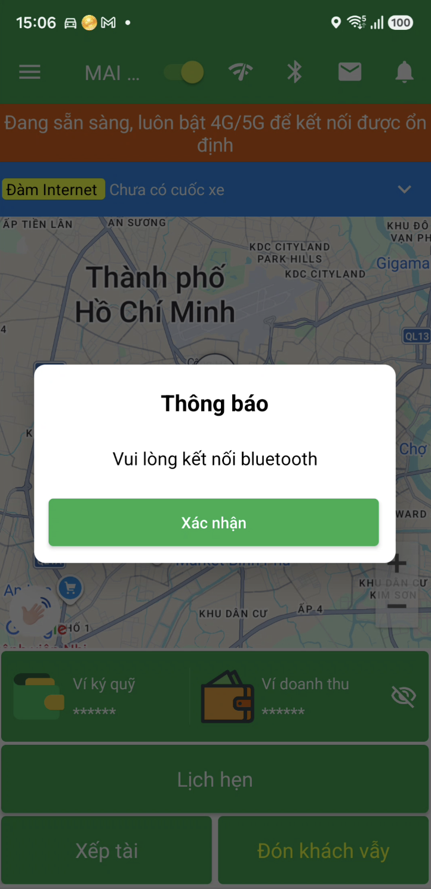
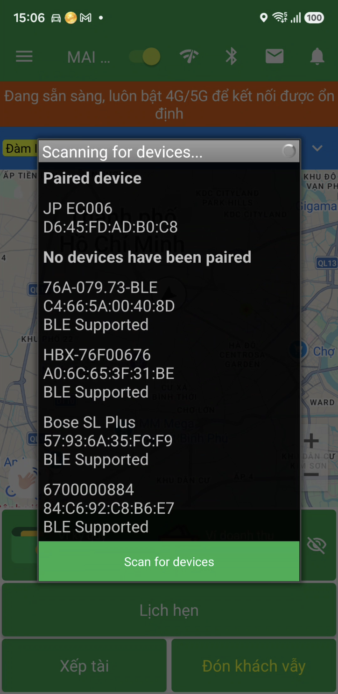
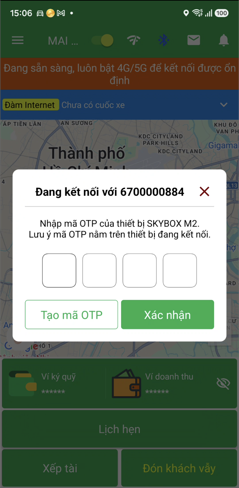
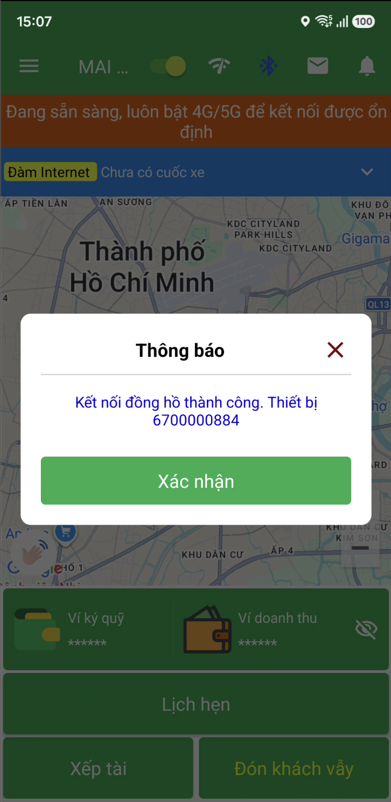
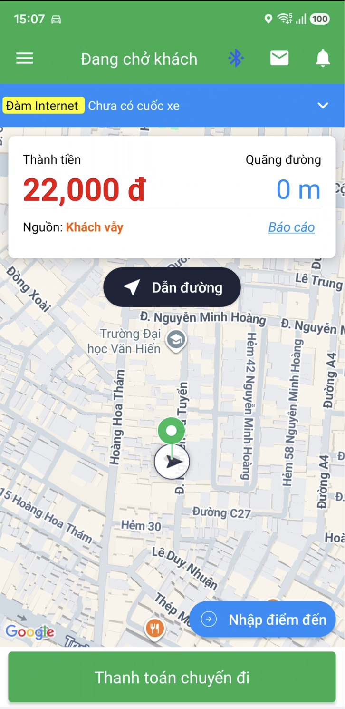
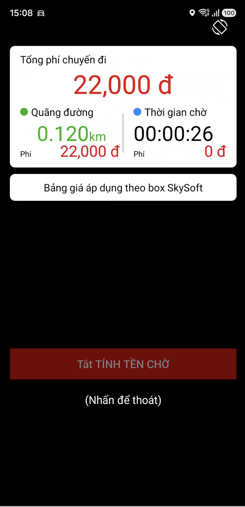

# Hướng dẫn kết nối và sử dụng đồng hồ SKYSOFT

Hướng dẫn này dành cho tài xế sử dụng **thiết bị đồng hồ SkySoft** trong App VNDriver, bao gồm cả phần **kết nối thiết bị** và **theo dõi/thao tác trong chuyến đi**.

## Mục tiêu

- Kết nối App VNDriver với **thiết bị đồng hồ SkySoft** qua **Bluetooth BLE**.
- Nhập **OTP** của thiết bị để bắt đầu tính cước.
- Theo dõi đúng các thông tin hiển thị trong chuyến đi và thực hiện **thanh toán chuyến đi** đúng quy trình.

## Điều kiện trước

Trước khi thao tác, cần đảm bảo:

- **Bluetooth** trên điện thoại đã được bật.
- Điện thoại có **kết nối 4G/5G ổn định** trong suốt quá trình sử dụng.
- **Thiết bị đồng hồ SkySoft** đã sẵn sàng.
- Tài xế chọn đúng **thiết bị ghép nối**.

!!! warning "Quan trọng"
    Nếu Bluetooth chưa kết nối hoặc chọn sai thiết bị, App sẽ không thể kết nối đồng hồ để bắt đầu tính cước.

## Các bước kết nối đồng hồ

### 1. Mở danh sách thiết bị và chọn đúng đồng hồ hỗ trợ BLE

Trong màn hình kết nối đồng hồ, App hiển thị danh sách thiết bị đã ghép nối. Hãy chọn đúng thiết bị đồng hồ có hỗ trợ **BLE**.

{: loading=lazy }

!!! note "Lưu ý"
    Chỉ chọn thiết bị đồng hồ đã ghép nối thành công với điện thoại. Nếu thiết bị không hỗ trợ BLE hoặc chưa ghép nối, App có thể không kết nối được.

### 2. Kiểm tra cảnh báo khi Bluetooth chưa kết nối

Nếu Bluetooth chưa kết nối với đồng hồ, App sẽ hiển thị cảnh báo để tài xế kiểm tra lại.

{: loading=lazy }

**Cách xử lý:**

1. Kiểm tra Bluetooth trên điện thoại đã bật.
2. Đưa điện thoại lại gần thiết bị đồng hồ SkySoft.
3. Kiểm tra thiết bị đã ghép nối đúng chưa.
4. Thử chọn lại thiết bị trong danh sách.

### 3. Chọn thiết bị đồng hồ cần kết nối

Sau khi chọn đúng thiết bị, App hiển thị trạng thái chuẩn bị kết nối. Ví dụ thiết bị được chọn là **6700000884**.

{: loading=lazy }

### 4. Nhập OTP in trên thiết bị đồng hồ SkySoft

Khi App yêu cầu xác thực, nhập đúng **OTP được in trên thiết bị đồng hồ SkySoft** rồi xác nhận để kết nối.

OTP gồm đúng 4 chữ số, mỗi chữ số là `0` hoặc `1`, ví dụ `1010`.

{: loading=lazy }

!!! tip "Mẹo"
    Nhập chính xác từng số của OTP. Nếu nhập sai, hãy kiểm tra lại mã trên thiết bị trước khi thử lại.

### 5. Quan sát màn hình chuyến đi sau khi kết nối

Sau khi kết nối thành công và chuyến đi đang được thực hiện, App hiển thị màn hình đồng hồ để tài xế theo dõi trạng thái và các thông tin chính của chuyến đi.

{: loading=lazy }

### 6. Hoàn tất chuyến đi

Sau khi thanh toán, màn hình hoàn tất sẽ hiển thị:

- **Tổng phí**
- **Quãng đường**
- **Thời gian chờ**
- Tùy chọn **Tắt tính tiền chờ** nếu cần

Cuối cùng, thoát màn hình để kết thúc quy trình.

{: loading=lazy }

## Cách sử dụng đồng hồ sau khi kết nối thành công

Sau khi kết nối xong với thiết bị đồng hồ SkySoft, tài xế sử dụng màn hình đồng hồ theo trình tự dưới đây.

### 1. Xác nhận trạng thái chuyến đi

Khi chuyến đang diễn ra, kiểm tra màn hình có hiển thị trạng thái **Đang chở khách**.

- Đây là dấu hiệu để tài xế xác nhận đang ở đúng màn hình sử dụng đồng hồ trong chuyến.
- Nếu trên màn hình có hiển thị **Nguồn**, ví dụ **Nguồn: Khách vẫy**, tài xế có thể đối chiếu để nhận biết loại chuyến đang xử lý.

### 2. Theo dõi các thông tin chính trên màn hình đồng hồ

Trong lúc di chuyển, tài xế cần quan sát các thông tin đang được hiển thị, gồm:

- **Thành tiền**
- **Quãng đường**

Các thông tin này giúp tài xế theo dõi tình trạng chuyến đi ngay trên màn hình đồng hồ trong App.

### 3. Nhấn `Thanh toán chuyến đi` khi kết thúc hành trình

Khi đã đến điểm trả khách và cần kết thúc chuyến, nhấn **Thanh toán chuyến đi** trên màn hình.

!!! note "Lưu ý"
    Chỉ thực hiện thao tác này khi chuyến đi đã kết thúc và tài xế cần chuyển sang bước xem thông tin thanh toán.

### 4. Kiểm tra thông tin ở màn hình hoàn tất chuyến đi

Sau khi chuyển sang màn hình hoàn tất, tài xế kiểm tra các mục hiển thị như:

- **Tổng phí chuyến đi**
- **Quãng đường**
- **Thời gian chờ**
- **Phí**

Đây là các thông tin cần đối chiếu trước khi rời màn hình kết thúc chuyến.

### 5. Sử dụng `Tắt tính tiền chờ` khi phù hợp

Nếu trên màn hình có tùy chọn **Tắt tính tiền chờ**, tài xế sử dụng khi cần theo đúng tình huống thực tế của chuyến đi.

!!! note "Lưu ý"
    Tài liệu này chỉ hướng dẫn nhận biết và thao tác theo nội dung hiển thị trên màn hình. Không suy luận thêm ngoài các thông tin đang được App thể hiện.

### 6. Thoát màn hình sau khi kiểm tra xong

Sau khi đã xem xong thông tin chuyến đi, nhấn thao tác thoát theo nội dung hiển thị **(Nhấn để thoát)** để rời màn hình hoàn tất.

## Ghi chú và xử lý sự cố

### Không thấy thiết bị đồng hồ trong danh sách

- Kiểm tra thiết bị đồng hồ SkySoft đã bật chưa.
- Kiểm tra điện thoại đã bật Bluetooth chưa.
- Xác nhận thiết bị đã được ghép nối trước đó.
- Chỉ chọn thiết bị có hỗ trợ **BLE**.

### App báo chưa kết nối Bluetooth

- Tắt và bật lại Bluetooth trên điện thoại.
- Đặt điện thoại gần đồng hồ hơn để tín hiệu ổn định.
- Chọn lại đúng thiết bị đồng hồ trong danh sách.

### Nhập OTP không thành công

- Kiểm tra lại OTP in trên thiết bị.
- Nhập lại cẩn thận, đúng từng ký tự/số.
- Nếu OTP thay đổi theo thiết bị, luôn dùng mã đang hiển thị/in trên đồng hồ đang kết nối.

### Đồng hồ hoạt động không ổn định giữa chuyến

- Đảm bảo mạng **4G/5G ổn định**.
- Không tắt Bluetooth trong khi đang chạy chuyến.
- Giữ điện thoại đủ pin để tránh ngắt kết nối giữa chừng.

## Kết quả mong đợi

Sau khi thực hiện đúng các bước trên:

- App VNDriver kết nối thành công với **thiết bị đồng hồ SkySoft**.
- Tài xế nhập OTP thành công và vào đúng màn hình sử dụng đồng hồ trong chuyến đi.
- Có thể theo dõi trạng thái **Đang chở khách**, các mục **Thành tiền**, **Quãng đường**, và nguồn chuyến nếu có hiển thị.
- Có thể thực hiện **Thanh toán chuyến đi**, kiểm tra thông tin hoàn tất chuyến, dùng **Tắt tính tiền chờ** khi phù hợp, rồi **thoát màn hình** đúng quy trình.
